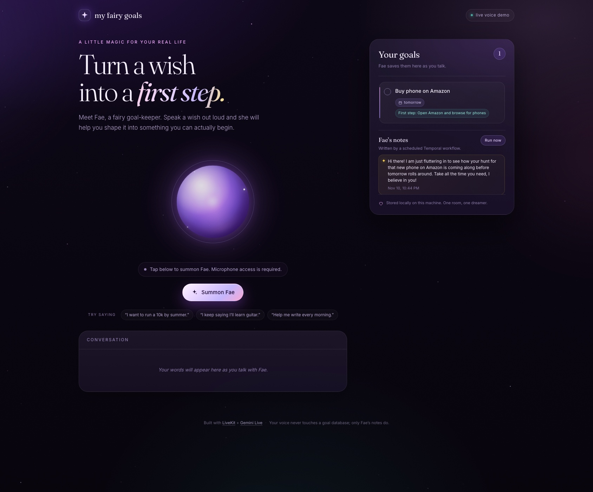
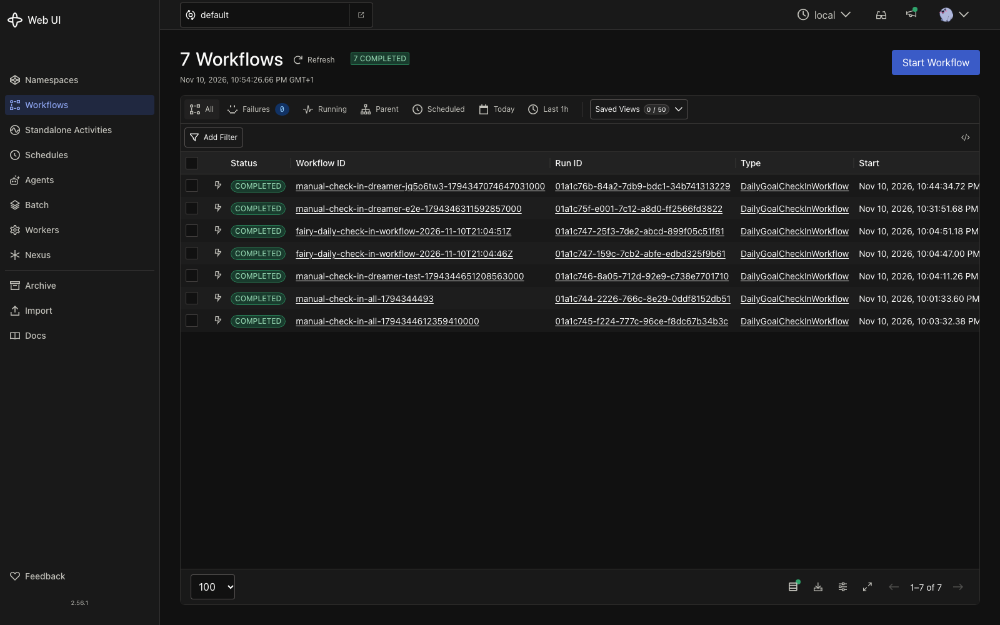
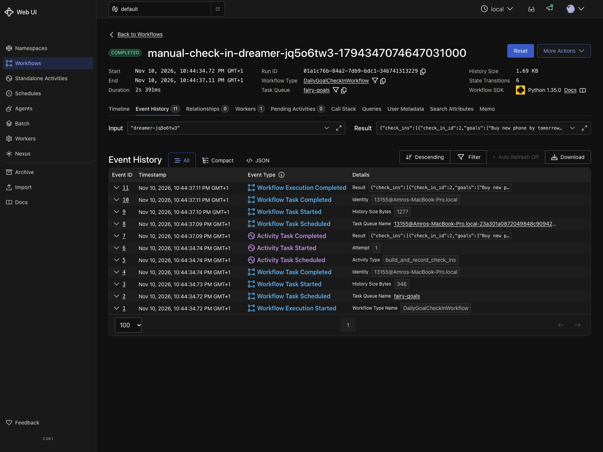
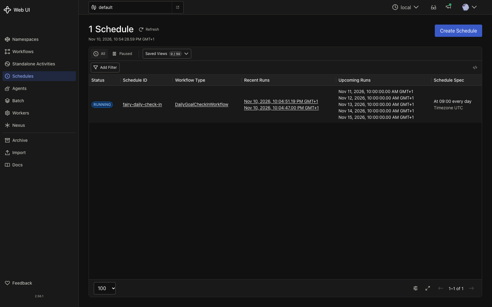

# My Fairy Goals

A live voice demo built with **LiveKit Agents** and **Google Gemini Live**. Talk to **Fae**, a fairy goal-keeper, and watch your spoken wishes turn into saved goal cards on screen in real time.

- **Speech-to-speech** — Gemini Live handles listening and speaking, so no separate STT/TTS keys are needed.
- **Live transcription** — your conversation appears as it happens.
- **Real tool calls** — Fae saves, completes, and removes goals through function tools backed by SQLite.
- **Live UI updates** — goal cards appear instantly through a LiveKit data channel.
- **Local by default** — the LiveKit server, token server, SQLite database, and web UI all run on your machine. The only cloud service is Gemini.



---

## Quick start

```bash
./scripts/setup.sh    # Python deps + local LiveKit server + .env
# add your Google key to .env
./scripts/dev.sh      # or: make dev
```

Then open **http://localhost:3000** and click **Summon Fae**. Allow microphone access and start talking.

> On macOS, `make dev` can fail with an `xcrun: error: active developer path ... does not exist` if Xcode was removed. Either run `./scripts/dev.sh` directly or prefix the command with `DEVELOPER_DIR=/Library/Developer/CommandLineTools`.

Get a Gemini API key at **https://aistudio.google.com/apikey** (it starts with `AIza`).

```dotenv
# .env
GOOGLE_API_KEY=AIza...
```

> The demo refuses to start until the placeholder key is replaced, so you get a clear message instead of a mysterious agent crash.

---

## How it works

```
┌──────────────────────┐        WebRTC audio + data         ┌─────────────────────────┐
│  Browser (web/)      │ ◄────────────────────────────────► │  livekit-server --dev   │
│  livekit-client SDK  │                                    │  ws://localhost:7880    │
└──────────┬───────────┘                                    └────────────┬────────────┘
           │ token                                    auto-dispatched job │
           ▼                                                                 ▼
┌──────────────────────┐                                    ┌─────────────────────────┐
│  FastAPI (server.py) │                                    │  Fae (fairy_agent.py)   │
│  /api/token          │                                    │  livekit-agents 1.8     │
│  /api/goals          │◄────────── SQLite ─────────────────►│  Gemini Live realtime   │
└──────────────────────┘               data/goals.db         └─────────────────────────┘
```

1. The browser asks the FastAPI server for a LiveKit token.
2. It joins the `fairy-goals` room and publishes the microphone.
3. The agent worker auto-joins the room and opens a Gemini Live speech-to-speech session.
4. Fae's tool calls write to SQLite and publish a fresh goal snapshot on the `goals` data topic.
5. The browser renders the transcript and goal cards. Completing or deleting a card calls the same store.

The agent uses automatic dispatch (`@server.rtc_session()` with no `agent_name`), which is why no extra dispatch call is needed.

---

## Architecture and connections

Everything runs on your machine except Gemini. There are two planes:

- **Host (macOS):** browser, FastAPI server, LiveKit, the voice agent, and the Python Temporal worker.
- **minikube (namespace `temporal`):** Temporal frontend/history/matching/worker, the Temporal Web UI, and PostgreSQL.

The important boundary: **nothing connects to the Temporal worker.** It has no inbound port. It dials the Temporal frontend and long-polls the `fairy-goals` task queue. The FastAPI server also dials Temporal; it never calls the worker.

### Who listens, who dials

```
                   arrows point from initiator → listener

 Browser
   │ HTTP :3000                    │ WS/WebRTC :7880
   ▼                               ▼
 FastAPI (LISTEN :3000)         LiveKit (LISTEN :7880, :7881)
   │ gRPC :7233                   ▲ WS/WebRTC
   ▼                              │
 kubectl port-forward         Voice agent (LISTEN :54064/65)
   │ tunnel                       │ WSS
   ▼                              ▼
 Temporal frontend           Gemini Live API
   ▲
   │ gRPC :7233 (long-poll)
 Python worker (NO inbound port) ──HTTPS──► Gemini text API
```

Verified with `lsof` while the stack is running:

```text
worker    127.0.0.1:55120 -> 127.0.0.1:7233   ESTABLISHED
agent     127.0.0.1:54067 -> 127.0.0.1:7880   ESTABLISHED
server    127.0.0.1:3000                     LISTEN
worker    (no LISTEN entry at all)
```

The host ports `7233` and `8080` are **kubectl tunnels**, not Temporal itself:

```text
host 127.0.0.1:7233  ══ kubectl port-forward ══►  svc/temporal-frontend:7233
host 127.0.0.1:8080  ══ kubectl port-forward ══►  svc/temporal-web:8080
```

### Connection setup

```
WORKER STARTUP                        SERVER → TEMPORAL (lazy)
────────────────                      ───────────────────────
worker                  frontend      FastAPI               frontend
  │ TCP connect 127.0.0.1:7233          │                     │
  ├──────────────────────►│             │ first /run request  │
  │ gRPC PollWorkflowTaskQueue          │ TCP connect :7233   │
  ├──────────────────────►│             ├────────────────────►│
  │◄── task / keep open ──┤             │ gRPC StartWorkflow  │
  │        (repeat)       │             ├────────────────────►│
                                          │◄── workflow id ───┤
                                          │  (channel reused)  │
```

### “Run now” sequence

```
Browser      FastAPI       Temporal       Worker        SQLite      Gemini
  │ POST run    │              │              │             │           │
  ├────────────►│ StartWorkflow│              │             │           │
  │             ├─────────────►│ persist      │             │           │
  │◄── 200 ─────┤◄─ workflow id│              │             │           │
  │             │              │◄─ poll ──────┤             │           │
  │             │              ├─ task ──────►│ read goals  │           │
  │             │              │              ├────────────►│           │
  │             │              │              │ note prompt │           │
  │             │              │              ├─────────────┼──────────►│
  │             │              │              │◄─ note ─────┼───────────┤
  │             │              │              ├─ INSERT ───►│           │
  │ GET notes   │              │              │             │           │
  ├────────────►│ SELECT check_ins            │             │           │
  │◄── notes ───┤              │              │             │           │
```

FastAPI finishes its HTTP response before the worker runs. The browser sees the
new note on its next `GET /api/check-ins` poll, reading the row the worker wrote.

### Daily schedule

```
Temporal Schedule  (cron 0 9 * * * UTC, stored in Postgres)
        │
        ▼
Temporal frontend creates DailyGoalCheckInWorkflow
        │
        ▼
Python worker receives the task on the fairy-goals queue
        │
        ├── SQLite: read active goals
        ├── Gemini text API: write the note
        └── SQLite: INSERT into check_ins
```

No browser or FastAPI involvement. The UI simply reads the new row later.

### Voice path

```
Browser  ──WS signalling :7880──►  LiveKit  ◄──WS :7880──  Voice agent
   │                                  ▲                        │
   └──── WebRTC audio (UDP 7882) ─────┘                        │ WSS
                                                               ▼
                                                        Gemini Live API

Voice agent ──SQL read──► data/goals.db (newest check_in → Fae's instructions)
```

LiveKit relays the media; the browser and agent never connect to each other
directly.

### Failure boundaries

| Stop this | Still works | Breaks |
| --- | --- | --- |
| Python worker | `Run now` accepts the workflow; work queues in Temporal | no notes are written |
| Temporal | web UI, voice, existing SQLite reads | `Run now` → 503; schedules do not fire |
| LiveKit or voice agent | notes + web UI | voice sessions |
| FastAPI | worker and schedules keep writing notes | web UI and API |
| PostgreSQL | nothing in Temporal | workflow history and visibility |

Only the worker's **outbound** connections touch Temporal, Gemini, and SQLite.

---

## Project layout

```
agent / server
  backend/fairy_agent.py   Fae's persona, tools, Gemini Live session
  backend/server.py        LiveKit token endpoint, goals + check-ins API
  backend/goals.py         SQLite goal store (goals + scheduled check-ins)
  backend/temporal/        Temporal worker, workflow, activity, schedule CLI
deploy/temporal/           Namespace, PostgreSQL, NetworkPolicy, Helm values
  README.md                Ownership, pinned versions, secrets, validation
.github/workflows/ci.yml   Unit tests + Helm lint/template + kubeconform
web/
  index.html               Voice UI
  styles.css               Magical aurora / orb / glass design
  app.js                   LiveKit client, audio visualiser, transcripts, goals
scripts/
  setup.sh                 One-time install
  dev.sh                   Runs LiveKit + web server + agent together
  temporal-up.sh           minikube + Postgres + Temporal + port-forwards
  temporal-down.sh         Stops port-forwards (or --purge everything)
docs/
  app-ui.jpg               Screenshot used at the top of this README
  temporal-*.png           Temporal workflow, history, and schedule screenshots
tests/
  test_goals.py            Store unit tests
  test_check_ins.py        Check-in activity unit tests
```

---

## Configuration

All settings live in `.env`.

| Variable | Default | Meaning |
| --- | --- | --- |
| `GOOGLE_API_KEY` | — | Gemini API key (required) |
| `LIVEKIT_URL` | `ws://localhost:7880` | Server URL used by the agent and token response |
| `PUBLIC_LIVEKIT_URL` | falls back to `LIVEKIT_URL` | Browser-facing URL, useful behind a proxy |
| `LIVEKIT_API_KEY` | `devkey` | Local dev server key |
| `LIVEKIT_API_SECRET` | `secret` | Local dev server secret |
| `GOOGLE_LIVE_MODEL` | `gemini-3.8-live` | Gemini Live model. Older `gemini-2.5-flash-native-audio-*` previews can close the socket with a `1007` “audio content type not supported” error mid-session. |
| `FAIRY_VOICE` | `Aoede` | Gemini voice: `Aoede`, `Puck`, `Kore`, `Leda`, `Zephyr`, `Charon`, `Fenrir`, `Orus` |
| `FAIRY_ROOM` | `fairy-goals` | Default room name |
| `GOALS_DB` | `data/goals.db` | SQLite file location |
| `FAIRY_NOTE_MODEL` | `gemini-3.5-flash-lite,gemini-3.8-flash` | Comma-separated cheap text models for scheduled notes, tried in order (falls back to a template) |
| `FAIRY_NOTE_ATTEMPTS` | `3` | Attempts per note model on transient errors (429/503) before trying the next |
| `FAIRY_NOTE_TIMEOUT` | `20` | Seconds to wait for one note-model response before treating it as transient |
| `TEMPORAL_ADDRESS` | `127.0.0.1:7233` | Temporal frontend address |
| `TEMPORAL_NAMESPACE` | `default` | Temporal namespace |
| `TEMPORAL_TASK_QUEUE` | `fairy-goals` | Queue shared by the worker and schedules |
| `TEMPORAL_SCHEDULE_CRON` | `0 9 * * *` | Daily check-in cadence |
| `TEMPORAL_SCHEDULE_TZ` | `UTC` | IANA time zone for the cron expression |

### Using LiveKit Cloud instead of the local server

Create a free project at https://cloud.livekit.io, then set:

```dotenv
LIVEKIT_URL=wss://your-project.livekit.cloud
LIVEKIT_API_KEY=...
LIVEKIT_API_SECRET=...
```

Run the token server and agent without starting the local server:

```bash
make server     # terminal 1
make agent      # terminal 2
```

The agent connects out to LiveKit Cloud, so no inbound ports are required.

---

## Scheduled jobs with Temporal

Scheduled check-ins are durable **Temporal workflows**. Once a day a workflow
scans every dreamer's active goals, writes a short note into the `check_ins`
SQLite table (separate from `goals`), and the web UI shows it under **Fae's
notes**. At the start of the next voice session, Fae receives the newest note as
context and can follow up on it naturally.

### One-time infrastructure (minikube + Helm)

Requires Docker (Docker Desktop or Colima), `minikube`, `kubectl`, and `helm`.
Bring the whole stack up with:

```bash
make temporal-up
```

This starts Colima if the Docker daemon is down, starts minikube, then:

1. applies `deploy/temporal/namespace.yaml`;
2. creates the `temporal-postgres` Secret on first run with a random password
   (it is never written to Git);
3. applies a NetworkPolicy that only allows Temporal chart pods to reach port `5432`;
4. applies the PostgreSQL Service and StatefulSet and waits for them to roll out;
5. installs the pinned `temporal/temporal` chart with `deploy/temporal/values.yaml`;
6. port-forwards the frontend and Web UI.

| Endpoint | Purpose |
| --- | --- |
| `localhost:7233` | Temporal frontend used by the Python SDK |
| http://localhost:8080 | Temporal Web UI (workflows, schedules, runs) |

The first install takes a few minutes while images are pulled. The chart's
schema job creates the `temporal` / `temporal_visibility` databases
automatically.

**Versions are pinned:** Helm chart `1.8.0` (`TEMPORAL_CHART_VERSION` in
`scripts/temporal-up.sh`) and `postgres:16.15-alpine`. Bump them deliberately,
not implicitly.

**Ownership is explicit:** the namespace, Secret, PostgreSQL StatefulSet, and
NetworkPolicy are owned by this repo; the Temporal Deployments, Services, Jobs,
and Web UI are rendered by Helm. Only Temporal runs in Kubernetes — FastAPI, the
worker, LiveKit, and the voice agent stay on the host. See
[`deploy/temporal/README.md`](deploy/temporal/README.md) for the full ownership
table, secret rotation, and the NetworkPolicy CNI caveat.

CI (`.github/workflows/ci.yml`) runs the unit tests, `helm lint`,
`helm template`, and `kubeconform` on every push.

> `helm.temporal.io` does not resolve on every network, so the setup script
> uses the GitHub Pages mirror `https://temporalio.github.io/helm-charts`.

### Run the worker and create the schedule

```bash
make temporal-worker     # terminal 1: polls the fairy-goals task queue
make temporal-schedule   # terminal 2: creates fairy-daily-check-in
```

The default cadence is 09:00 UTC. Override it in `.env`:

```dotenv
TEMPORAL_SCHEDULE_CRON=0 9 * * *
TEMPORAL_SCHEDULE_TZ=Europe/Amsterdam
```

Scheduled notes are written ahead of time by a cheap text model
(`FAIRY_NOTE_MODEL`, default `gemini-3.5-flash-lite,gemini-3.8-flash`) and stored
in SQLite. The models are tried cheapest first; transient `429`/`503` responses
are retried briefly before the next model. The
realtime Gemini Live model is only used during actual voice sessions, where
audio tokens are much more expensive; it receives the newest stored note as
context when the dreamer connects. If no `GOOGLE_API_KEY` is set, or the text
model call fails, the worker falls back to a deterministic template so the
schedule still runs.

The worker must be running for scheduled workflows to execute; runs are durable
and will be picked up when it reconnects.

### Trigger a check-in manually

- **UI:** click **Run now** next to *Fae's notes* (runs the workflow for the
  current dreamer).
- **CLI:** `make temporal-run` starts one workflow directly;
  `make temporal-schedule-trigger` triggers the schedule instead.
- **Temporal UI:** open http://localhost:8080 and use *Trigger* on the schedule.

```bash
make temporal-schedule-list   # list schedules
```

### How it fits together

See [Architecture and connections](#architecture-and-connections) for the
socket-level view, connection setup, and failure boundaries.

```
Temporal Schedule (cron)
        │
        ▼
DailyGoalCheckInWorkflow ──activity──► SQLite: check_ins
                                             │
                     GET /api/check-ins ◄────┘
                                             │
                                   Browser “Fae's notes”
                                             │
                          next voice session → Fae's instructions
```

Stop the port-forwards with `make temporal-down`. To delete the Helm release and
the PostgreSQL data as well, run `./scripts/temporal-down.sh --purge`.

### What it looks like in the Temporal UI

**Workflows** — every scheduled and manual check-in is a durable run:



**Event history** — the 11 events of one run, including the workflow input, the
`build_and_record_check_ins` activity, and the result showing which model wrote
the note (`source: model:gemini-3.5-flash-lite`):



**Schedules** — the cron spec, recent runs, and upcoming runs:



---

## Playing with Fae

Try:

- “I want to run a 10k by summer, but I keep putting it off.”
- “I've been saying I'll learn guitar for two years.”
- “Help me build a morning writing habit.”
- “What goals do I have?”
- “I finished the writing one — mark it done.”

Fae asks one question at a time, reflects back what she hears, and only saves a goal after you agree on the wording. Goal cards update live in the right-hand panel.

To reset everything, run `make reset-goals`. The browser keeps a random `dreamer-...` identity in `localStorage`, which is how goals persist between sessions.

---

## Customising

- **Persona and coaching style** — edit `INSTRUCTIONS` in `backend/fairy_agent.py`.
- **Tools** — add a `@function_tool` method to the `Fairy` class. Gemini Live calls it automatically.
- **Model** — set `GOOGLE_LIVE_MODEL`. The default here is `gemini-3.8-live`; other Live models your key can use include `gemini-3.1-flash-live-preview`. Avoid the `gemini-2.5-flash-native-audio-*` previews for long sessions: they can close with `1007` and the plugin then ends the session instead of reconnecting.
- **Look** — the palette and orb live in `web/styles.css` (`:root` variables and the `.orb` block).
- **Voice** — set `FAIRY_VOICE`; `Aoede` is airy and fairy-like.
